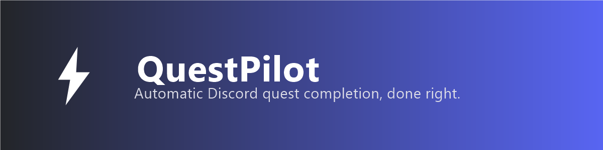

# QuestPilot

A rewrite of [nvckai/Discord-Web-Auto-Quest-Extension](https://github.com/nvckai/Discord-Web-Auto-Quest-Extension) (itself based on [aamiaa's original script](https://gist.github.com/aamiaa/204cd9d42013ded9faf646fae7f89fbb)), with a cleaner codebase and a redesigned floating widget.

Completes your Discord quests automatically — video, desktop game, desktop stream, and activity quests — from a single floating button, with live per-quest progress bars instead of console-only logs.

> [!CAUTION]
> Discord has suspended quest access for accounts caught automating quest completion. **Use at your own risk.**

> [!IMPORTANT]
> Educational / security-research project. It demonstrates webpack module interception and user-agent spoofing in a browser extension. You are responsible for how you use it and for Discord's Terms of Service.

## What's different from the original

- **Redesigned widget**: Discord-themed floating pill with a spinner/success/error state, and an expandable panel with animated per-quest progress bars (not just raw numbers).
- **No external image dependency**: icons are inline SVG instead of third-party CDN images — faster, more private, and won't break if a CDN link dies.
- **Persisted panel state** via `chrome.storage.local`, so the panel stays open/closed across page reloads.
- **Cleaner code**: the quest engine, UI, and background worker are split into dedicated files, errors are logged instead of silently swallowed, and duplicated constants were removed.
- **Unused file removed**: the old `user-agent-check.js` wasn't referenced anywhere and was dropped.

The core mechanism — reading Discord's internal `QuestsStore` through webpack and completing quests sequentially — is unchanged, since it's the part that actually has to match Discord's client behavior.

## Installation

1. Download or clone this repo.
2. Open `chrome://extensions/` (or your Chromium browser's equivalent).
3. Enable **Developer mode** (top right).
4. Click **Load unpacked** and select this folder.

## Usage

1. Go to [discord.com/quest-home](https://discord.com/quest-home) and accept the quests you want to complete.
2. Click the **Run Quests** button that appears bottom-right.
3. Click the chevron to expand the panel and watch live progress bars per quest.
4. Open the console (F12) for detailed logs if something looks off.

For streaming quests, you still need another person in the voice channel — the extension can't fake that part.

## How it works

- **User-Agent override**: a `declarativeNetRequest` rule plus a `MAIN`-world content script make Discord think you're on the desktop app, which some quest types require.
- **Webpack module interception**: the quest engine hooks into Discord's `QuestsStore` and internal API client directly in the page's JS context.
- **Sequential completion**: quests are processed one at a time, polling progress via the same endpoints the real client uses (video progress / heartbeat).

## Project structure

```
manifest.json
background.js                   # service worker: injects the quest engine on click
rules.json                       # declarativeNetRequest header rule
src/content/
  userAgentOverride.js           # MAIN-world UA/platform spoof, runs at document_start
  questWidget.js                 # the floating button + panel UI (isolated content script)
  questEngine.js                 # MAIN-world quest completion logic, injected on demand
```

## Requirements

- Chrome or any Chromium-based browser (Edge, Brave, etc.) — also works on Android via [Lemur Browser](https://play.google.com/store/apps/details?id=com.lemurbrowser.exts).
- A Discord account with quests accepted on the quest-home page.

## License

GPL-3.0, same as the project this was built from. See [LICENSE](LICENSE).
